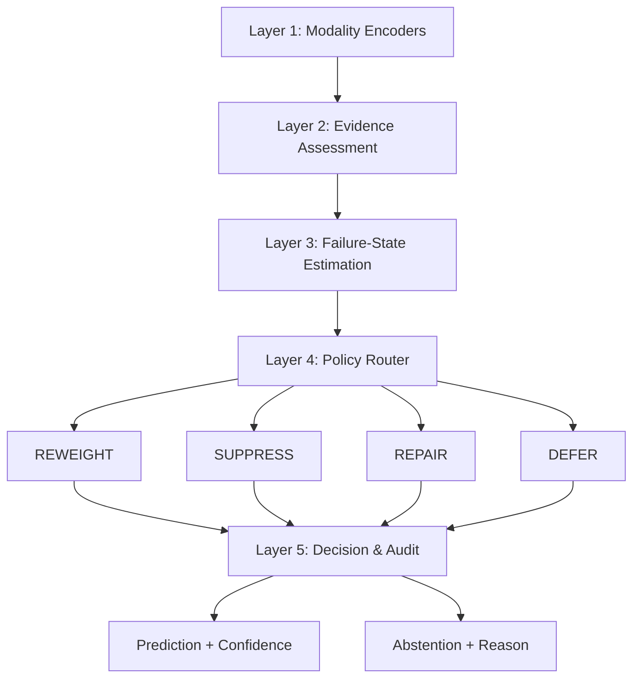
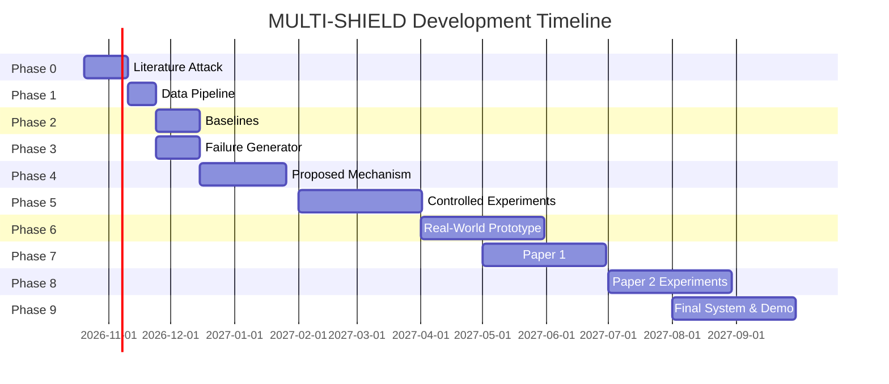

# MULTI-SHIELD — Development Master Plan

> **Full Title:** MULTI-SHIELD: Failure-Aware Decision Policies for Reliable Multimodal AI under Compound Degradation  
> **Domain:** Artificial Intelligence & Machine Learning  
> **Research Area:** Robust Multimodal Learning · Trustworthy AI · Uncertainty Estimation · Selective Prediction  
> **Sources:** [Master Project Blueprint (56 pages)](file:///d:/123Major_Project/MULTI-SHIELD%20%E2%80%94%20Master%20Project%20Blueprint.pdf) · [Master Project Plan (31 pages)](file:///d:/123Major_Project/MULTI-SHIELD%20%E2%80%94%20Master%20Project%20Plan.pdf)

---

## Table of Contents

1. [What the Project Is](#1-what-the-project-is)
2. [What It Is Focusing On](#2-what-it-is-focusing-on)
3. [What Is the Cause (The Problem)](#3-what-is-the-cause-the-problem)
4. [How We Intend to Resolve It](#4-how-we-intend-to-resolve-it)
5. [What Is Our Approach](#5-what-is-our-approach)
6. [What Are Other Approaches](#6-what-are-other-approaches)
7. [Why Is Our Approach Better](#7-why-is-our-approach-better)
8. [Already-Present Approaches & How We Differ](#8-already-present-approaches--how-we-differ)
9. [The Core of Our Solution](#9-the-core-of-our-solution)
10. [Target Users](#10-target-users)
11. [What It Targets](#11-what-it-targets)
12. [How the Architecture Works](#12-how-the-architecture-works)
13. [References](#13-references)
14. [Our Greatest Contribution](#14-our-greatest-contribution)
15. [Impact](#15-impact)
16. [How to Make Impact Stronger](#16-how-to-make-impact-stronger)
17. [Comparison with Others & How We Stack Up](#17-comparison-with-others--how-we-stack-up)
18. [Development Roadmap (What Needs to Be Done)](#18-development-roadmap-what-needs-to-be-done)
19. [Master Comparison Matrix: All Approaches](#19-master-comparison-matrix-all-approaches)

---

## 1. What the Project Is

MULTI-SHIELD is a **reliability-aware multimodal AI architecture** that investigates how an AI system can:

1. **Identify** unreliable, missing, noisy, contradictory, or potentially manipulated modalities
2. **Dynamically decide** how much each modality should influence the final decision
3. **Abstain** entirely when evidence is collectively insufficient

### What MULTI-SHIELD is NOT

| ❌ NOT This | ✅ But This |
|:---|:---|
| Another multimodal classifier | A **reliability diagnosis and decision framework** |
| Another sentiment-analysis model | An investigation into **evidence management before prediction** |
| Simple missing-modality imputation | **Compound failure diagnosis and adaptive intervention** |
| Simple attention-based fusion | **Failure-state-conditioned policy routing** |
| A generic "trust score" | **Multi-dimensional reliability state** (confidence + uncertainty + agreement + quality + failure type) |

> [!IMPORTANT]
> The single sentence to remember:
> *"MULTI-SHIELD investigates whether multimodal AI can become more reliable by explicitly diagnosing the reliability and failure state of heterogeneous evidence before deciding how that evidence should influence the final prediction."*

---

## 2. What It Is Focusing On

The candidate research direction is:

> **Reliability diagnosis and decision-making under compound cross-modal failure.**

The central question:

> *Can a multimodal AI system distinguish different **causes** of cross-modal unreliability and dynamically alter its fusion and decision policy according to the **diagnosed reliability state**?*

### The Key Word: **Diagnose**

Not simply:
> *"This modality has weight 0.2."*

But:
> *"**Why** is its reliability low? Is it missing? Noisy? Contradicting other evidence? Or just providing complementary but different information?"*

### Five Innovation Layers Under Investigation

| Layer | Description | Status |
|:---|:---|:---|
| **A. Reliability Diagnosis** | Determine *why* a modality is unreliable | Core hypothesis |
| **B. Failure-Aware Fusion** | Fusion policy changes per diagnosed failure state | Core mechanism |
| **C. Compound-Failure Handling** | Evaluate combinations, not just isolated failures | Key differentiator |
| **D. Selective Decision (Abstention)** | System can abstain when evidence is insufficient | Safety feature |
| **E. Reliability Benchmark (MS-Bench)** | Controlled benchmark with multiple failure types/severities | Potential contribution |

> [!NOTE]
> We cannot claim all five as novel. The literature review determines which becomes the actual contribution.

---

## 3. What Is the Cause (The Problem)

### The Assumption That Fails

Modern AI increasingly combines text, images, audio, video, sensor streams, and structured data. The assumption is:

$$\text{More modalities} \rightarrow \text{More information} \rightarrow \text{Better decisions}$$

**This assumption fails** when one or more modalities are:

| Failure Type | Example | Severity |
|:---|:---|:---|
| **Missing** | Camera feed drops, audio unavailable | Common in deployment |
| **Noisy** | Audio contains heavy interference | Gradual degradation |
| **Corrupted** | Input technically present but information is damaged | Hard to detect |
| **Contradictory** | Image → DOG, Text → CAT | Ambiguous without context |
| **Misleading/Manipulated** | Intentionally altered modality | Adversarial scenario |
| **Semantically Ambiguous** | Individually valid but describe different aspects | Requires contextual reasoning |
| **Collectively Insufficient** | All available evidence is weak | Requires abstention |

### The Four Root Causes (from Project Plan)

```
A. Missing Evidence        → Camera drops, audio unavailable, data source fails
B. Degraded Evidence       → Noise, occlusion, blur, compression, interference
C. Conflicting Evidence    → Modalities produce inconsistent interpretations
D. Compound Degradation    → Multiple problems occurring simultaneously
```

### Why It Matters (Evidence from Literature)

- **ICLR 2025**: Foundation models recognize conflicts in unimodal contexts far more reliably than across modalities (cross-modal attention imbalance)
- **ICML 2025**: Modality conflict formalized as a source of hallucination (MMMC dataset)
- **AISTATS 2025**: Uncertainty estimation becomes particularly difficult when modalities conflict
- **2026 Survey**: Organizes reliability challenges into overlapping categories with unresolved questions in low-quality multimodal learning

> [!WARNING]
> **The Most Dangerous Scientific Mistake:**
> $$\text{Cross-Modal Disagreement} \neq \text{Unreliability}$$
> *Example: Image → person smiling, Text → "I am sad" — both can be valid (sarcasm, suppressed emotion). Disagreement does not automatically mean one modality is wrong.*
> 
> The system must distinguish: **True contradiction** vs. **Complementary information** vs. **Ambiguity** vs. **Noise** vs. **Missing evidence**

---

## 4. How We Intend to Resolve It

### The Research Hypothesis

> *A multimodal system that explicitly diagnoses modality reliability and conditions its fusion/abstention policy on that diagnosis will be more robust under compound modality degradation than conventional and recent adaptive-fusion approaches.*

### The Three-Part Decision Process

```
                    ┌─────────────────────────────────┐
                    │     MULTIMODAL INPUT             │
                    │  (Image · Audio · Text)          │
                    └───────────────┬─────────────────┘
                                    │
                    ┌───────────────▼─────────────────┐
                    │   1. DIAGNOSE                    │
                    │   What is the condition of each  │
                    │   input? Missing? Noisy?         │
                    │   Corrupted? Contradictory?      │
                    │   Healthy?                       │
                    └───────────────┬─────────────────┘
                                    │
                    ┌───────────────▼─────────────────┐
                    │   2. DECIDE                      │
                    │   Which intervention is most     │
                    │   useful given the diagnosed     │
                    │   failure state?                 │
                    └───────────────┬─────────────────┘
                                    │
                    ┌───────────────▼─────────────────┐
                    │   3. ACT & EVALUATE              │
                    │   Apply intervention, predict    │
                    │   or defer, measure outcome      │
                    └─────────────────────────────────┘
```

### The Four Candidate Actions

| Action | When to Use | Risk |
|:---|:---|:---|
| **REWEIGHT** — use less, not none | Modality remains informative but less reliable | May still include noisy signal |
| **SUPPRESS** — exclude entirely | Modality is likely to harm the decision | May discard valid complementary info |
| **REPAIR** — attempt recovery | Degraded representation reconstructable from other modalities | Reconstructed features may hallucinate |
| **DEFER** — decline prediction | Remaining information doesn't justify a reliable decision | Reduces coverage/throughput |

> [!TIP]
> **Development Strategy:** Start with `{REWEIGHT, SUPPRESS, DEFER}` in Phase 1. Introduce `REPAIR` only after the baseline policy is proven stable. REPAIR is technically high-risk — synthesized features can inject hallucinations.

---

## 5. What Is Our Approach

### The MULTI-SHIELD Approach (Failure-State-Conditioned Policy Routing)

```
Multimodal inputs
        ↓
Estimate evidence quality AND failure state
        ↓
Select an action BASED ON the diagnosed state
        ↓
    ┌───────┬──────────┬────────┐
    │       │          │        │
 Reweight  Suppress  Repair   Defer
    │       │          │        │
    └───────┴──────────┴────────┘
        ↓
Prediction or Abstention
```

**The research question:** *Does knowing the **type** of failure improve the choice of intervention?*

### How This Differs from Normal ML

| Paradigm | Process | Limitation |
|:---|:---|:---|
| **Normal ML** | Input → Model → Prediction | No evidence assessment |
| **Conventional Multimodal** | Image + Audio + Text → Fusion → Prediction | Assumes all inputs useful |
| **Adaptive Weighting** | Inputs → Estimate reliability → Calculate continuous weights → Fuse → Predict | Doesn't distinguish *why* reliability is low |
| **MULTI-SHIELD** | Inputs → Diagnose *what's wrong* → Select appropriate intervention → Fuse adaptively → Predict/Abstain | Evidence management *before* decision-making |

### The Important Distinction

> We are **NOT claiming** that existing methods literally cannot suppress or abstain. Some already support related capabilities.
> 
> Our question is narrower: **Does explicitly modelling failure states and conditioning intervention selection on those states outperform a strong, fairly tuned continuous-weighting baseline under compound degradation?**

---

## 6. What Are Other Approaches

### Comprehensive Landscape of Existing Approaches

| # | Approach | How It Works | Key Methods | Limitation We Investigate |
|:---|:---|:---|:---|:---|
| 1 | **Fixed Fusion** (Early/Late/Attention) | Combines all modalities using fixed architecture | Tensor Fusion Network, early concat, late averaging | Cannot adapt to sample-specific failures |
| 2 | **Adaptive Weighting** | Changes each modality's contribution according to estimated reliability | DMS (2025), attention-based weighting | Does continuous weighting suffice for severe/interacting failures? |
| 3 | **Missing-Modality Learning** | Trains model to handle absent inputs | Modality dropout, prompt learning, MCCF (2026) | Doesn't automatically solve noise, conflict, and corruption together |
| 4 | **Uncertainty-Aware Fusion** | Uses uncertainty estimates to influence predictions | Evidential Deep Learning, Discounted Belief Fusion (AISTATS 2025) | Uncertainty alone may not identify *which intervention* is appropriate |
| 5 | **Restoration/Imputation** | Reconstructs missing or damaged information | PRIME (2026), autoencoders, cross-modal generation | Reconstructed features may be inaccurate or misleading |
| 6 | **Conflict-Aware Methods** | Detects and handles cross-modal disagreement | MMMC (ICML 2025), conflict-aware attention | May not distinguish valid divergence from corruption |
| 7 | **Selective Prediction** | Abstains when prediction risk too high | Conformal prediction, risk-coverage methods | Must be integrated with reliability management |
| 8 | **Sensor-Failure Robustness** | Expert-based handling of sensor dropout | Multi-Modal Expert Fusion (CVPR 2025) | Domain-specific, doesn't generalize failure taxonomy |

---

## 7. Why Is Our Approach Better

### Three Hypothesized Advantages

| Advantage | Explanation | How We Test It |
|:---|:---|:---|
| **1. More Appropriate Intervention** | The system learns that *different conditions* may favour *different actions* — a missing modality needs SUPPRESS, a noisy one needs REWEIGHT, a contradictory one needs conflict-specific handling | Compare action-selection quality vs. uniform weighting |
| **2. Better Compound-Failure Handling** | The policy considers multiple degraded modalities *jointly* rather than treating each failure in isolation | Stress-test with 2-way and 3-way compound degradation |
| **3. More Responsible Decisions** | The system can DEFER when evidence is inadequate rather than forcing a prediction | Measure selective risk (AURC) and risk-coverage trade-offs |

### Honest Acknowledgement of Disadvantages

| Disadvantage | Reality |
|:---|:---|
| **Complexity** | A policy router adds architectural complexity |
| **Cascading Error** | Misdiagnosed failure states propagate to wrong interventions |
| **Repair Risk** | Cross-modal reconstruction can introduce hallucinations |
| **Overhead** | Multiple diagnostic signals + policy evaluation increases latency |

> [!IMPORTANT]
> We must **measure these costs** rather than assume the architecture is superior. If a strong scalar baseline performs equally well, the central hypothesis is not supported — and that is a valid research result, not a failure.

---

## 8. Already-Present Approaches & How We Differ

### Detailed Prior Art Comparison

| Existing Method | What It Does | What It Doesn't Do | How MULTI-SHIELD Differs |
|:---|:---|:---|:---|
| **PRIME (2026)** | Explicit reliability diagnosis → prototype-conditioned restoration → reassessment → reliability-weighted fusion | Doesn't model multiple *intervention types* as a policy choice; focuses on intent recognition | We investigate whether selecting among {Reweight, Suppress, Repair, Defer} based on failure state outperforms a single restoration + reweighting pipeline |
| **DMS (2025)** | Adaptive per-sample modality weighting via confidence, uncertainty, and semantic consistency | Uses *continuous scalar weights* — doesn't diagnose *why* reliability is low or offer discrete interventions | We condition the intervention on the *type* of failure, not just its magnitude |
| **MCCF (2026)** | Conformal fusion under missing modalities with calibrated uncertainty | Focused specifically on *missing* modalities; doesn't address noise, conflict, or compound failure | We extend beyond missingness to a full failure taxonomy under compound degradation |
| **MMMC (ICML 2025)** | Modality conflict formalized as hallucination source; benchmark dataset | Identifies conflict but doesn't offer a *decision policy* for handling it | We integrate conflict detection into a broader diagnosis-and-action framework |
| **AISTATS 2025 (Belief Fusion)** | Conflict-aware uncertainty estimation via evidential deep learning | Provides better uncertainty but doesn't route to different interventions | We use uncertainty as one *input signal* to a learned policy router |
| **CVPR 2025 (Expert Fusion)** | Multi-modal expert fusion under sensor failures for autonomous driving | Domain-specific (LiDAR + camera); doesn't generalize failure taxonomy | We propose a domain-agnostic failure diagnosis that works across text/audio/image |

### The Key Differentiator

```
EXISTING APPROACHES:
    reliability_score = estimate_reliability(modality)
    weight = f(reliability_score)              ← scalar adjustment
    prediction = weighted_fusion(all_modalities, weights)

MULTI-SHIELD:
    failure_state = diagnose_failure(modality)  ← categorical: missing/noisy/corrupted/conflicting/healthy
    action = policy_router(failure_state)       ← discrete: REWEIGHT/SUPPRESS/REPAIR/DEFER
    prediction = adaptive_fusion(modalities, actions)  OR  abstention
```

> The shift is from **"how much to trust"** (scalar) to **"what went wrong and what to do about it"** (diagnostic + policy).

---

## 9. The Core of Our Solution

The core is NOT the dashboard, NOT the module names, NOT the four action labels.

### The Core Is:

> **The experimental demonstration that failure-state-conditioned intervention selection provides a measurable advantage over existing alternatives.**

### Three Levels of Contribution

| Level | Contribution | Description |
|:---|:---|:---|
| **Primary** | **Failure-Aware Decision Policy** | Test whether a multi-class failure-state representation improves intervention selection under interacting degradation |
| **Supporting** | **Reproducible Compound-Degradation Evaluation Framework** | Evaluate missingness, noise, corruption, conflict and combinations using controlled severity, repeatable splits, documented metadata |
| **Practical** | **Explainable Reliability Dashboard** | Show detected condition, chosen action, confidence, latency, and outcome relative to baseline |

### The Strongest Possible Research Narrative

> *"Existing multimodal systems typically treat reliability as an implicit weighting problem. MULTI-SHIELD investigates reliability as an **explicit diagnostic state** that informs fusion and decision-making under **compound cross-modal degradation**."*

---

## 10. Target Users

MULTI-SHIELD is a **research framework**, not yet a standalone product. Its target users depend on the application:

| User Group | Use Case | Example Scenario |
|:---|:---|:---|
| **Assistive-Technology Developers** | Systems combining camera + speech + text that detect when evidence is inadequate | A visual assistance app that refuses to describe a scene when camera feed is corrupted rather than hallucinating |
| **Autonomous Systems Researchers** | Perception systems responding to sensor dropout, occlusion, conflicting measurements | Self-driving module that shifts trust from a foggy camera to LiDAR + radar |
| **Educational AI Developers** | Classroom assistants coping with noisy speech, incomplete lectures, unreliable OCR | Lecture summarizer that flags low-confidence audio segments instead of transcribing noise |
| **Industrial Monitoring Teams** | Reliable decisions when different sensors provide degraded/inconsistent evidence | Factory monitor that escalates when vibration sensor contradicts temperature readings |
| **Disaster Management Systems** | Satellite + sensor + field reports with contradictory information | Emergency system that flags conflicting ground reports vs. satellite imagery |

> [!TIP]
> **Recommended Strategy:** Use a multimodal sentiment/emotion benchmark (CMU-MOSI/MOSEI/MELD) as the controlled research environment. Build the demo around an assistive or monitoring scenario only if it can be validated without unsupported safety claims.

---

## 11. What It Targets

### Primary Research Target

The **compound degradation problem** — the scenario where multiple inputs fail simultaneously in different ways:

```
┌──────────────────────────────────────────────────┐
│              COMPOUND DEGRADATION                │
│                                                  │
│  Image → 30% corruption (occlusion/blur)         │
│  Audio → completely missing                      │
│  Text  → contradicts visual evidence             │
│                                                  │
│  This is NOT three independent problems.         │
│  The failures INTERACT.                          │
└──────────────────────────────────────────────────┘
```

### The Six Evaluation Dimensions

| Dimension | Metrics | Purpose |
|:---|:---|:---|
| **Prediction Quality** | Accuracy, Precision, Recall, F1, AUROC | Does it still get the right answer? |
| **Reliability/Calibration** | ECE, Brier Score, calibration curves | Does confidence match reality? |
| **Failure Diagnosis** | Failure classification F1, severity estimation error | Can it diagnose what went wrong? |
| **Robustness** | Performance degradation, relative robustness, area under degradation curve | How gracefully does it degrade? |
| **Selective Decision** | Coverage, selective risk, AURC, risk-coverage curve | Does it know when to abstain? |
| **Efficiency** | Inference latency, memory, parameter count, computational overhead | What does the policy cost? |

---

## 12. How the Architecture Works

### Full 5-Layer Architecture



### Layer-by-Layer Breakdown

#### Layer 1 — Modality Encoders
- **Purpose:** Convert each raw input into numerical feature representations
- **Implementation:** Frozen pretrained encoders (no giant foundation model training)
- **Models:** CLIP (image), BERT/RoBERTa (text), Audio Spectrogram Transformer / Wav2Vec (audio)
- **Key Decision:** Encoders are **frozen** — we operate on extracted feature embeddings, keeping training lightweight

#### Layer 2 — Evidence Assessment
- **Purpose:** Calculate diagnostic signals for each modality
- **Signals Computed:**
  - Predictive entropy (how uncertain is this modality's prediction?)
  - Epistemic uncertainty (is this out-of-distribution?)
  - Feature-quality indicators (signal-to-noise, completeness)
  - Cross-modal agreement (do modalities tell the same story?)
- **Critical Rule:** Each signal must be tested to verify it adds useful information

#### Layer 3 — Failure-State Estimation
- **Purpose:** Classify the likely condition of each modality
- **Output:** Probabilistic estimate over failure taxonomy: `{healthy, missing, noisy, corrupted, contradictory}`
- **Requirement:** Must output **uncertainty about the diagnosis itself** — cascading diagnosis error is a top risk
- **Implementation:** Classifier or probabilistic model trained on controlled degradation data

#### Layer 4 — Policy Router
- **Purpose:** Select an intervention based on the estimated failure state and expected utility
- **Actions:** `{REWEIGHT, SUPPRESS, REPAIR, DEFER}`
- **Training:** Learned from training data only — **never** supplied with ground-truth corruption labels at inference time
- **Key Constraint:** The policy must be evaluated fairly against a tuned scalar baseline

#### Layer 5 — Decision and Audit Output
- **Purpose:** Make prediction or defer; output full audit trail
- **Output Fields:**
  - Prediction class (or abstention)
  - Confidence score
  - Action taken per modality
  - Reason for action
  - Inference latency
  - Comparison with baseline decision

### The Reliability Engine (Where Novelty Lives)

```
┌─────────────────────────────┐
│     RELIABILITY ENGINE      │
├─────────────────────────────┤
│  • Confidence               │
│  • Uncertainty              │
│  • Cross-modal agreement    │
│  • Input quality            │
│  • Failure indicators       │
└──────────────┬──────────────┘
               ↓
      FAILURE DIAGNOSIS
               ↓
      RELIABILITY STATE
               ↓
      DECISION POLICY
               ↓
      ADAPTIVE FUSION
               ↓
      FINAL DECISION
               ↓
      CONFIDENCE / ABSTAIN
```

---

## 13. References

### Core Prior-Art References

| # | Paper | Year | Venue | Relevance |
|:---|:---|:---|:---|:---|
| 1 | **PRIME** — Adaptive Modality Reliability Diagnosis and Restoration for Robust Multimodal Intent Recognition | 2026 | arXiv | Closest competitor: explicit diagnosis, restoration, reassessment, reliability-weighted fusion |
| 2 | **DMS** — Dynamic Modality Scheduling via Confidence, Uncertainty, and Semantic Consistency | 2025 | arXiv | Adaptive per-sample weighting; strong scalar-weighting baseline |
| 3 | **MCCF** — Conformal Fusion Under Missing Modalities | 2026 | arXiv | Missing-modality robustness, evidential fusion, conformal calibration |
| 4 | **Multimodal Fusion on Low-Quality Data: A Comprehensive Survey** | 2026 | Information Fusion | Taxonomy of noisy, incomplete, quality-varying multimodal data |
| 5 | **Deep Multimodal Learning with Missing Modality: A Survey** | 2024 | arXiv | Breadth of missing-modality research |
| 6 | **Resilient Sensor Fusion via Multi-Modal Expert Fusion** | 2025 | CVPR | Sensor-failure robustness in autonomous driving |
| 7 | **Benchmarking Multi-modal Segmentation under Sensor Failures** | 2025 | CVPR Workshops | Controlled missing/noisy modality evaluation |
| 8 | **MMMC** — Robust MLLMs Against Modality Conflict | 2025 | ICML | Modality conflict → hallucination; MMMC benchmark |
| 9 | **Cross-Modal Attention Imbalance** — Why Foundation Models Struggle | 2025 | OpenReview | Foundation model failure under distributed conflicts |
| 10 | **Discounted Belief Fusion** — Multimodal Uncertainty Quantification | 2025 | AISTATS | Conflict-aware uncertainty estimation |

### Dataset & Tooling References

| Resource | Description | Use |
|:---|:---|:---|
| **CMU-MOSI** | 2,199 opinion-video clips with sentiment labels | Small, controlled initial experiments |
| **CMU-MOSEI** | Larger collection with sentiment and emotion annotations | Main robustness experiments |
| **MELD** | Multimodal dialogue with emotion/sentiment annotations | Cross-dataset transfer testing |
| **MMMC** | Modality-conflict benchmark | Conflict-focused experiments |
| **CMU Multimodal SDK** | Dataset access and processing toolkit | Data pipeline foundation |

### Technology Stack

| Layer | Tools |
|:---|:---|
| **Language** | Python |
| **Framework** | PyTorch |
| **Models** | Hugging Face Transformers |
| **Vision** | OpenCV |
| **Audio** | librosa / torchaudio |
| **Data** | NumPy, Pandas, scikit-learn |
| **Visualization** | matplotlib, Plotly |
| **Dashboard** | Streamlit or Next.js |

---

## 14. Our Greatest Contribution

### Not the interface. Not the module names. Not the four action labels.

The greatest possible result is:

> Demonstrating on unseen compound-degradation conditions that:
> 1. MULTI-SHIELD achieves **lower selective risk** at comparable coverage
> 2. It maintains **competitive Macro-F1** on clean data
> 3. It chooses interventions **more effectively** than a tuned scalar baseline
> 4. The improvement **transfers to another dataset**
> 5. Its additional computation is **justified by the benefit**

### If We Also Solve This, It Becomes Exceptional:

> **Distinguishing valid semantic divergence from genuine evidence failure.**
>
> This becomes a research contribution ONLY if we can:
> - Define it rigorously
> - Label it reliably
> - Demonstrate that the distinction improves decisions

### The Four Critical Distinctions

| Concept | Definition | NOT the same as: |
|:---|:---|:---|
| **Reliability** | How trustworthy is this modality for the current decision? | Confidence |
| **Confidence** | How confident is the model in its prediction? | Reliability |
| **Uncertainty** | How much uncertainty exists around the prediction? | Disagreement |
| **Agreement** | Do modalities provide consistent evidence? | Reliability |

> Explicitly separating these is where the project becomes substantially more sophisticated than simple attention-weighting.

---

## 15. Impact

### Six Impact Dimensions

| # | Impact Area | Description |
|:---|:---|:---|
| 1 | **Safety** | A system should not confidently act on corrupted evidence |
| 2 | **Reliability** | Gracefully degrade rather than catastrophically fail |
| 3 | **Explainability** | Instead of "Confidence = 0.87", provide: "Image and audio agree; text conflicts; text reliability reduced" |
| 4 | **Robustness** | Performance becomes less sensitive to individual modality failure |
| 5 | **Operational Efficiency** | System can avoid processing/trusting unreliable streams unnecessarily |
| 6 | **Research Infrastructure** | A controlled framework for studying multimodal failure |

### SDG Alignment

| SDG | Alignment | Condition |
|:---|:---|:---|
| **SDG 9** (Industry, Innovation, Infrastructure) | Strongest general alignment | Demonstrated through research output |
| **SDG 10** (Reduced Inequalities) | Relevant IF assistive-technology application is validated | Requires user studies, not just benchmarks |

---

## 16. How to Make Impact Stronger

In priority order:

| # | Strategy | Why It Matters |
|:---|:---|:---|
| 1 | **Demonstrate genuine performance/risk advantage** | A reliable result > a complicated architecture |
| 2 | **Release reproducible experiments** | Corruption generators, configs, eval scripts, model checkpoints |
| 3 | **Test generalisation** | Show gains persist across datasets, severities, unseen combinations |
| 4 | **Make decisions explainable** | Display failures, interventions, uncertainty — without claiming perfect causal explanation |
| 5 | **Validate one application** | Work with a real user group before claiming safety/accessibility benefits |
| 6 | **Create MS-Bench** | A reusable benchmark with {Missing, Noise, Corruption, Conflict, Manipulation, Compound} at controlled severities |

---

## 17. Comparison with Others & How We Stack Up

### Direct Comparison Targets

| vs. Method | What We Must Demonstrate | If Successful |
|:---|:---|:---|
| **Fixed Fusion** | Better degradation resilience | Shows the value of adapting to input quality |
| **DMS / Scalar Weighting** | Better risk or robustness under compound failure | Supports the central policy hypothesis |
| **PRIME** | Better decisions where *different interventions* are needed | Establishes distinction from diagnosis + restoration |
| **MCCF** | Complementary value beyond missingness calibration | Shows action routing adds beyond calibrated uncertainty |
| **Conflict-Focused Methods** | Better handling of valid divergence vs. genuine failure | Supports semantic-diagnosis component |
| **Selective Prediction Methods** | Better risk-coverage trade-off | Supports deferral policy |

### The Expected Comparison Table (Illustrative)

```
                    Clean   Noise   Missing   Conflict   Compound
Baseline              94      73       62        55         39
Adaptive baseline     95      82       76        70         58
MULTI-SHIELD          95      90       87        85         81
```

> [!NOTE]
> These are illustrative numbers, NOT expected results. The real result determines whether the hypothesis survives.

### Three Possible Outcomes

| Outcome | What It Means | Response |
|:---|:---|:---|
| **Best Case** | Policy routing produces statistically significant improvements in selective risk + compound robustness, retains clean performance, generalises cross-dataset | **Strong research contribution.** |
| **Mixed Result** | Policy helps only for particular failure combinations or cost constraints | Narrow the contribution to those conditions; explain when routing is useful. |
| **Negative Result** | Strong scalar baseline performs equally or better | Simplify model; investigate *why*; reconsider research question. **This is NOT a failed project — an unsupported novelty claim is the greater risk.** |

---

## 18. Development Roadmap (What Needs to Be Done)

### Phase-by-Phase Execution Plan



### Detailed Phase Breakdown

#### Phase 0 — Literature Attack (Weeks 1–3)
> **DO NOT BUILD THE FINAL SYSTEM YET.**

| Task | Deliverable |
|:---|:---|
| Read and dissect PRIME (2026) and DMS (2025) | Structured comparison matrix |
| Map 8 literature families (fusion, missing, noise, conflict, reliability, adaptive, selective, hallucination) | Literature family matrix |
| Determine what MULTI-SHIELD can contribute that prior art doesn't | Finalized research gap statement |
| Run Phase 0 Kill Check | Go/No-Go decision |

#### Phase 1 — Data Pipeline (Weeks 3–5)

| Task | Deliverable |
|:---|:---|
| Load CMU-MOSI, CMU-MOSEI, MELD | Dataset loaders |
| Align modalities (text, audio, visual) | Alignment pipeline |
| Validate data integrity (missing values, sync, label quality, duplicates, train/test leakage) | Data audit report |
| Create reproducible train/validation/test splits | Split configuration |

#### Phase 2 — Baselines (Weeks 5–8)

| Task | Deliverable |
|:---|:---|
| Implement Early Fusion | Baseline 1 results |
| Implement Late Fusion | Baseline 2 results |
| Implement Attention Fusion | Baseline 3 results |
| Implement strong recent adaptive method (DMS-style) | Baseline 4 results |
| Establish Macro-F1, accuracy, calibration, runtime on clean data | Baseline benchmark report |

#### Phase 3 — Failure Generator (Weeks 7–10)

| Task | Deliverable |
|:---|:---|
| Build modality missing generator | Missing modality pipeline |
| Build noise injection (Gaussian, progressive 10%→90%) | Noise pipeline |
| Build corruption injection (occlusion, blur, compression) | Corruption pipeline |
| Build conflict injection (swap modality labels) | Conflict pipeline |
| Build compound failure combinations (2-way, 3-way) | Compound pipeline |
| Create metadata records (sample ID, modality, degradation type, severity, ground truth) | Degradation metadata schema |

#### Phase 4 — Proposed Mechanism (Weeks 10–16)

| Task | Deliverable |
|:---|:---|
| Implement Reliability Engine (confidence, uncertainty, agreement, quality, failure indicators) | Evidence assessment module |
| Implement Failure-State Estimator (probabilistic classifier over failure taxonomy) | Diagnosis module |
| Implement Policy Router (maps failure state → action selection) | Policy router module |
| Implement individual actions (REWEIGHT, SUPPRESS, DEFER) | Action modules |
| Implement REPAIR (cross-modal reconstruction + reassessment) — Phase 2 only | Repair module (conditional) |
| Integration testing | End-to-end MULTI-SHIELD prototype |

#### Phase 5 — Controlled Experiments (Months 4–6)

Full experimental suite:

| Experiment | Purpose |
|:---|:---|
| **E0** — Dataset integrity | Validate before any ML |
| **E1** — Normal condition (clean data) | Ensure no clean-data sacrifice |
| **E2** — Missing modality | Test each modality missing, pairs missing |
| **E3** — Noise (10%→90% progressive) | Determine degradation curve |
| **E4** — Cross-modal contradiction | Measure conflict detection + prediction + abstention |
| **E5** — Semantic corruption | Valid input, wrong semantic content |
| **E6** — Manipulated modality | Can system isolate suspicious evidence? |
| **E7** — Compound failure (THE KILLER EXPERIMENT) | Image 30% corrupt + Audio missing + Text contradicts |
| **E8** — Abstention | All modalities unreliable → system should defer |
| **E9** — Severity analysis | At what level does system stop being trustworthy? |
| **E10** — Ablation | Remove one component at a time → measure contribution |
| **E11** — Cross-dataset generalisation | General principles vs. memorized corruption patterns |

#### Phase 6 — Real-World Prototype (Months 6–8)
- Choose ONE practical domain (assistive tech, industrial monitoring, or smart city)
- Validate with naturally occurring degradation where possible
- Build interactive demo dashboard

#### Phase 7–9 — Papers, Final System, Demo (Months 7–12)

| Phase | Deliverable |
|:---|:---|
| Paper 1 | "Failure-State-Conditioned Decision Policies for Robust Multimodal Learning" |
| Paper 2 (conditional) | "Evaluating Multimodal Failure Diagnosis under Compound Degradation and Semantic Divergence" |
| Final Demo | Interactive dashboard with corruption sliders, real-time reliability visualization, baseline comparison |

### Team Division (4 People)

| Person | Responsibilities |
|:---|:---|
| **Person 1** — Research + Multimodal Modeling | Literature, baseline architectures, encoders, fusion |
| **Person 2** — Reliability/Diagnosis | Corruption generator, reliability estimation, conflict detection, uncertainty |
| **Person 3** — Evaluation | Benchmarks, experiments, ablations, statistical analysis, reproducibility |
| **Person 4** — System + Visualization | API, dashboard, simulation, experiment controls, deployment |

### Four-Review College Survival Strategy

| Review | Show | Don't Show |
|:---|:---|:---|
| **Review 1** | Problem + literature + gap hypothesis | "We finished MULTI-SHIELD" |
| **Review 2** | Baseline + failure benchmark: "Existing methods degrade under controlled failures" | Final architecture claims |
| **Review 3** | MULTI-SHIELD prototype + preliminary results: "Our mechanism changes the degradation curve" | Unvalidated novelty claims |
| **Review 4** | Complete validation: benchmark + ablation + statistical analysis + real-world demo + limitations + papers | Everything omitted earlier |

---

## 19. Master Comparison Matrix: All Approaches

This is the comprehensive compare-and-contrast of every approach discussed:

### Dimension 1: What Each Approach Diagnoses

| Approach | Diagnoses Failure Type? | Diagnoses Severity? | Diagnoses Compound Failures? | Distinguishes Conflict from Corruption? |
|:---|:---:|:---:|:---:|:---:|
| Fixed Fusion | ❌ | ❌ | ❌ | ❌ |
| Adaptive Weighting (DMS) | ❌ (uses confidence as proxy) | Partially (via weight magnitude) | ❌ (treats independently) | ❌ |
| Missing-Modality Learning | Only missing | ❌ | ❌ | ❌ |
| Uncertainty-Aware (AISTATS '25) | ❌ (uncertainty ≠ diagnosis) | ❌ | ❌ | Partially |
| PRIME (2026) | ✅ (prototype-based) | Partially | ❌ (focuses on intent recognition) | ❌ |
| MMMC (ICML '25) | Only conflict | ❌ | ❌ | ❌ |
| Sensor Expert Fusion (CVPR '25) | Only sensor dropout | ❌ | ❌ | ❌ |
| **MULTI-SHIELD** | **✅ (full taxonomy)** | **✅ (progressive)** | **✅ (core focus)** | **✅ (research target)** |

### Dimension 2: What Actions Each Can Take

| Approach | Reweight | Suppress | Repair | Defer/Abstain |
|:---|:---:|:---:|:---:|:---:|
| Fixed Fusion | ❌ | ❌ | ❌ | ❌ |
| Adaptive Weighting (DMS) | ✅ (continuous) | Implicit (weight→0) | ❌ | ❌ |
| Missing-Modality Learning | ❌ | Implicit | Sometimes (imputation) | ❌ |
| Uncertainty-Aware | ✅ (uncertainty-based) | ❌ | ❌ | Partially |
| PRIME (2026) | ✅ | ❌ | ✅ (restoration) | ❌ |
| MCCF (2026) | ❌ | ❌ | ❌ | ✅ (conformal) |
| **MULTI-SHIELD** | **✅** | **✅** | **✅** | **✅** |

### Dimension 3: Evaluation Capabilities

| Approach | Clean Performance | Robustness Curves | Calibration | Selective Risk | Failure Diagnosis Metrics | Compound Testing |
|:---|:---:|:---:|:---:|:---:|:---:|:---:|
| Fixed Fusion | ✅ | ❌ | ❌ | ❌ | ❌ | ❌ |
| DMS | ✅ | Partial | ❌ | ❌ | ❌ | ❌ |
| PRIME | ✅ | ❌ | ❌ | ❌ | Partial | ❌ |
| MCCF | ✅ | ❌ | ✅ | ✅ | ❌ | ❌ |
| **MULTI-SHIELD** | **✅** | **✅** | **✅** | **✅** | **✅** | **✅** |

### Dimension 4: Core Philosophy Comparison

| Approach | Core Question | Mechanism | Weakness |
|:---|:---|:---|:---|
| **Fixed Fusion** | "How to combine all modalities?" | Static architecture | Zero adaptability |
| **Adaptive Weighting** | "How much should each modality contribute?" | Continuous scalar weights | Doesn't know *why* to reweight |
| **Missing-Modality** | "What to do when input is absent?" | Imputation / dropout training | Only handles one failure type |
| **Uncertainty-Aware** | "How uncertain is the prediction?" | Evidential/Bayesian estimates | Uncertainty ≠ actionable diagnosis |
| **Restoration (PRIME)** | "Can we fix the damaged input?" | Prototype-conditioned reconstruction | Repair may introduce hallucinations |
| **Conflict-Aware (MMMC)** | "Do modalities agree?" | Conflict detection | Agreement ≠ reliability |
| **MULTI-SHIELD** | "What went wrong, and what should we do about it?" | Diagnosis → Policy → Action | Complexity; cascading diagnosis errors |

### Final Verdict: Strengths & Weaknesses Summary

| Criterion | MULTI-SHIELD Strength | MULTI-SHIELD Weakness |
|:---|:---|:---|
| **Comprehensiveness** | Only framework addressing full failure taxonomy + compound failures + selective prediction | Broad scope risks incomplete implementation |
| **Actionability** | Discrete intervention selection (Reweight/Suppress/Repair/Defer) | Policy router adds complexity and error propagation risk |
| **Scientific Rigour** | Pre-registered kill conditions, ablation plans, failure-boundary analysis | Unproven until experiments validate hypothesis |
| **Practical Value** | Explainable audit trail for every decision | Dashboard may consume development time |
| **Research Novelty** | Failure-state-conditioned policy under compound degradation | PRIME (2026) is close; must demonstrate clear delta |
| **Generalisability** | Domain-agnostic design | Synthetic corruption may not transfer to real degradation |

---

> [!IMPORTANT]
> ## The Next Move
> 
> **Do not start coding.**
> 
> The next move is the **Phase 0 Literature-Gap Attack**:
> 1. Build a structured matrix of the closest recent methods across: missing modality, noisy modality, conflict, uncertainty, adaptive fusion, restoration, abstention, compound degradation
> 2. Determine exactly what MULTI-SHIELD can contribute that those systems do not already provide
> 3. Only after that: freeze the architecture, research questions, and final title
> 
> *The dashboard, fancy architecture diagram, and name are secondary. The research loop is the actual project.*
